<div dir="rtl">

# رایگان (rayegan)

**هوش مصنوعی رایگان برای برنامه‌نویس ایرانی. یک دستور، بدون کلید، و روی بعضی اینترنت‌های ایران حتی بدون VPN.**

</div>

  

```bash
npx github:ssepehrnoush/rayegan
```

<div dir="rtl">

۷ آبان ۱۴۰۵، از اینترنت ماهان و بدون فیلترشکن، همین دستور بدون هیچ ثبت‌نامی بالا آمد و مدل رایگان Kilo در ۲ ثانیه جواب داد. روی مخابرات تهران همان Kilo از ۲۹ مهر خطای ۴۰۳ می‌دهد و آنجا `--proxy` لازم است. [جزئیات اندازه‌گیری](#نتیجه-از-اینترنت-ایران)

</div>



<div dir="rtl">

هر کلید رایگانی هم که دارید (Groq، Gemini، OpenRouter و بقیه) پشت همان آدرس جمع می‌شود: باهوش‌ترین مدلی که هنوز سهمیه دارد جواب می‌دهد، و سهمیه‌اش که تمام شد خودکار نفر بعدی. پروکسی v2ray را می‌شناسد و با Cline، Continue، Aider و هر کدی که برای OpenAI نوشته شده کار می‌کند.

## مشکل

برنامه‌نویس ایرانی برای OpenAI و Claude نمی‌تواند پول بدهد. سرویس‌های رایگان هم هستند، ولی هر کدام یک سقف کوچک دارند: Gemini روزی چند ده درخواست، OpenRouter روزی ۵۰ تا، Groq دقیقه‌ای ۳۰ تا. کسی که با Cline یا Aider کار می‌کند، وسط کار به سقف یکی می‌خورد و باید دستی کلید و مدل را عوض کند.

جمع این سهمیه‌ها روی هم زیاد است. فقط کسی باید باشد که بشمارد، و وقتی یکی تمام شد برود سراغ بعدی.

مشکل دوم مال ایران است. Gemini گاهی اکانت ایرانی را حتی پشت VPN هم قبول نمی‌کند، و هر سرویس دیگری هم ممکن است امروز از شبکه شما باز باشد و فردا نه. هیچ جدولی در هیچ README نمی‌تواند این را از قبل بداند.

## راه‌اندازی در یک دقیقه

<div dir="ltr">

```bash
npx github:ssepehrnoush/rayegan
```

</div>

همین. بدون هیچ کلیدی، مدل‌های رایگان دو درگاه بی‌کلید (Kilo و OVHcloud، روی هم بیش از ده مدل) همین الان در زنجیره هستند. آدرس شما:

<div dir="ltr">

```
http://127.0.0.1:8787/v1      model: "auto"
```

</div>

داشبورد فارسی هم روی `http://127.0.0.1:8787/` است: کدام مدل آماده است، امروز از هر کدام چقدر مصرف شده، و کدام سرویس چرا بیرون مانده.

### اگر پشت پروکسی هستید

اگر v2ray یا Xray روی سیستم دارید، پورتش را بدهید:

<div dir="ltr">

```bash
npx github:ssepehrnoush/rayegan --proxy http://127.0.0.1:10808
npx github:ssepehrnoush/rayegan --proxy socks5://127.0.0.1:10808
```

</div>

اگر `HTTPS_PROXY` را از قبل گذاشته‌اید، خودش برش می‌دارد. در SOCKS5 اسم سایت به خود پروکسی داده می‌شود، نه IP، تا DNS داخلی (که برای سایت‌های بسته جواب غلط می‌دهد) وسط نیاید.

**همه چیز از پروکسی نمی‌رود.** موقع شروع، هر سرویس یک بار مستقیم امتحان می‌شود. اگر جواب داد، مستقیم می‌ماند (سریع‌تر، و حجم VPN مصرف نمی‌کند). فقط سرویسی که مستقیم ۴۰۳ بدهد یا وصل نشود، از پروکسی می‌رود. اگر سرویسی که مستقیم کار می‌کرد وسط کار ۴۰۳ بدهد، همان لحظه می‌رود پشت پروکسی. داشبورد کنار هر سرویس نشان می‌دهد «مستقیم» است یا «از پروکسی».

- همه چیز از پروکسی: `--proxy-all` یا `"proxyMode": "always"` در فایل تنظیمات.
- برای یک سرویس خاص، در فایل تنظیمات: `{ "id": "kilo", "proxy": "none" }` (همیشه مستقیم) یا یک آدرس پروکسی دیگر.

### اول ببینید چه چیزی از شبکه شما باز است

<div dir="ltr">

```bash
npx github:ssepehrnoush/rayegan doctor --chat
```

</div>

برای هر سرویس از همین شبکه یک درخواست واقعی می‌فرستد و می‌گوید: کار می‌کند، کلید لازم دارد، کلید غلط است، خطای ۴۰۳ می‌دهد (یعنی احتمالاً منطقه یا اکانت بسته است)، یا اصلاً جواب نمی‌دهد (یعنی احتمالاً فیلتر است و پروکسی لازم دارید). یک بار با VPN و یک بار بدون آن بزنید، فرقش را می‌بینید. حتی بدون کلید هم چک می‌کند هر سرویس از شبکه شما باز است یا نه، تا قبل از ثبت‌نام بدانید پروکسی لازم دارید یا نه.

### نتیجه از اینترنت ایران

بدون VPN. دو اندازه‌گیری اول از مخابرات تهران (AS58224) است و سومی از ماهان (AS44090). برای جدا کردن «بسته» از «کلید لازم دارد»، به هر سرویس یک درخواست با کلید ساختگی فرستاده شد: ۴۰۱ یعنی در باز است و فقط کلید می‌خواهد، ۴۰۳ یعنی شبکه ایران را رد می‌کند. خط تیره یعنی آن روز سنجیده نشد:

| سرویس | ۷ آبان ۱۴۰۵، ماهان | ۲۳ مهر ۱۴۰۵، مخابرات | ۱۵ مهر ۱۴۰۵، مخابرات |
|---|---|---|---|
| Kilo Gateway | ✅ کار می‌کند، بدون کلید؛ مدل رایگان در ۲ ثانیه جواب داد | ✅ کار می‌کند؛ مدل رایگان فارسی جواب داد | ✅ |
| OVHcloud | ❌ وصل نشد (۱۵ ثانیه بی‌جواب) | - | - |
| Groq | ❌ ۴۰۳ | ✅ در دسترس (۴۰۱) | ❌ ۴۰۳ |
| OpenRouter | ❌ ۴۰۳ | ⚠️ اول ۴۰۳ («Access denied by security policy»)، چند دقیقه بعد ۴۰۱ | ❌ ۴۰۳ |
| Mistral | ✅ در دسترس (۴۰۱) | ✅ در دسترس (۴۰۱) | ✅ |
| Cloudflare | - | ✅ در دسترس (۴۰۱) | ✅ |
| Cerebras | ❌ ۴۰۳ | ❌ ۴۰۳ | ❌ ۴۰۳ |
| NVIDIA NIM | ❌ ۴۰۳ | ❌ ۴۰۳ | ❌ ۴۰۳ |
| Gemini | - | نامعلوم؛ ۴۰۳ با صفحه خطای عمومی گوگل | نامعلوم |

در اندازه‌گیری ۱۵ مهر همان درخواست از یک سرور آلمان هم فرستاده شد و همه سرویس‌ها جز Gemini از آنجا در دسترس بودند. ۷ آبان OVHcloud از یک سرور استرالیا بی‌کلید جواب داد.

۲۹ مهر، روی مخابرات تهران، Kilo هم ۴۰۳ داد (دو بار، با `curl` مستقیم). پس جواب «بدون VPN کار می‌کند؟» به اپراتور و هفته بستگی دارد: Kilo روی ماهان امروز بی‌کلید و بی‌VPN جواب داد ولی روی مخابرات بسته است، OVHcloud از ایران وصل نمی‌شود و از پروکسی می‌رود، Mistral با کلید در دسترس مانده، و Groq که ۲۳ مهر روی مخابرات باز بود، ۷ آبان روی ماهان ۴۰۳ داد. OpenRouter نشان می‌دهد چرا هیچ جدولی کافی نیست: در یک صبح، به فاصله چند دقیقه، هم بسته بود هم باز. برای همین رایگان هر سرویس را اول مستقیم امتحان می‌کند و هر ۴۰۳ وسط کار را همان لحظه می‌برد پشت پروکسی.

۴۰۱ فقط یعنی دیوار شبکه رد شده. اینکه Groq با کلید واقعی هم از IP ایران جواب می‌دهد یا نه، هنوز سنجیده نشده. اگر کلید دارید و از ایران `doctor --chat` زدید، یا از اپراتور دیگری (همراه اول، ایرانسل) نتیجه متفاوتی گرفتید، خروجی را در یک issue بگذارید.

## سهمیه بیشتر: کلیدهای رایگان

هر کلیدی که اضافه کنید، مدل‌های آن سرویس به زنجیره اضافه می‌شوند. هیچ‌کدام کارت بانکی نمی‌خواهد.

| سرویس | متغیر | سقف رایگان (تقریبی) | نکته |
|---|---|---|---|
| Kilo Gateway | بدون کلید | دقیقه‌ای ۲۰، ساعتی ۲۰۰ برای هر IP | مدل‌های رایگانش هر چند هفته عوض می‌شوند؛ رایگان خودش پیدایشان می‌کند. طبق راهنمای Kilo، مدل‌های رایگان NVIDIA متن را لاگ می‌کنند |
| [OVHcloud AI Endpoints](https://www.ovhcloud.com/en/public-cloud/ai-endpoints/) | بدون کلید | هر مدل دقیقه‌ای ۲ برای هر IP | سرور در اروپا؛ می‌گوید روی داده آموزش نمی‌دهد و نگهش نمی‌دارد. Qwen3.5-397B و gpt-oss-120b دارد. از ایران مستقیم وصل نشد |
| [Groq](https://console.groq.com/keys) | `GROQ_API_KEY` | هر مدل دقیقه‌ای ۳۰، روزی ۱۰۰۰ | خیلی سریع |
| [Cerebras](https://cloud.cerebras.ai/) | `CEREBRAS_API_KEY` | هر مدل روزی یک میلیون توکن | خیلی سریع |
| [OpenRouter](https://openrouter.ai/keys) | `OPENROUTER_API_KEY` | کل حساب روزی ۵۰ | با یک بار شارژ ۱۰ دلاری، روزی ۱۰۰۰ |
| [NVIDIA NIM](https://build.nvidia.com/) | `NVIDIA_API_KEY` | دقیقه‌ای ۴۰ | مدل‌های بزرگ مثل Kimi و DeepSeek. شرایطش فقط برای آزمایش است |
| [Gemini](https://aistudio.google.com/apikey) | `GEMINI_API_KEY` | Flash روزی ۲۰، Flash-Lite روزی ۵۰۰ | نسخه رایگان روی متن شما آموزش می‌بیند. اکانتی که ایرانی ثبت شده ممکن است بسته باشد |
| [Mistral](https://console.mistral.ai/api-keys) | `MISTRAL_API_KEY` | ثانیه‌ای ۱ | |
| [Cloudflare](https://dash.cloudflare.com/profile/api-tokens) | `CLOUDFLARE_API_TOKEN` و `CLOUDFLARE_ACCOUNT_ID` | روزی ۱۰ هزار neuron | |

این عددها تا تاریخ ۲۰۲۶-۱۰-۲۹ بررسی شده‌اند و سرویس‌ها مدام عوضشان می‌کنند. برای همین رایگان به آن‌ها کورکورانه تکیه نمی‌کند: اگر سرویسی زودتر از این عددها خطای ۴۲۹ بدهد، همان مدل کنار می‌رود و حرف خود سرویس ملاک است.

کلیدها را یا به‌صورت متغیر محیطی بدهید، یا در فایل `rayegan.json` در همان پوشه (نمونه‌اش: [`rayegan.example.json`](rayegan.example.json)). این فایل در `.gitignore` است؛ کلیدتان را کامیت نکنید.

## چطور کار می‌کند

۱. **پیدا کردن مدل‌ها.** موقع شروع، و بعد هر ۶ ساعت، از هر سرویس فهرست مدل‌های فعلی‌اش را می‌گیرد. مدل‌های رایگان را نگه می‌دارد و با یک [فهرست رتبه‌بندی](src/providers.json) از باهوش‌ترین به ساده‌ترین مرتب می‌کند. مدلی که در فهرست نیست وارد زنجیره نمی‌شود، تا یک مدل یک‌میلیاردی تازه به اول صف نپرد.

۲. **شمردن.** برای هر سرویس و هر مدل می‌شمارد امروز چند درخواست و چند توکن رفته و این دقیقه چند تا. اگر سقف پر باشد، اصلاً درخواست نمی‌فرستد.

۳. **رد شدن به نفر بعد.** اگر مدلی ۴۲۹ داد، یا خطا داد، یا **با کد ۲۰۰ جواب خالی برگرداند**، درخواست می‌رود سراغ مدل بعدی. کاربر فقط یک جواب می‌بیند.

۴. **کنار گذاشتن مدل خراب، به اندازه.** هر مدل قطع‌کننده خودش را دارد:

| اتفاق | چه می‌شود |
|---|---|
| ۴۲۹ | اگر سرویس `Retry-After` گفته باشد همان‌قدر، وگرنه ۱ دقیقه، بعد ۵، بعد ۳۰ |
| مدل حذف شده (۴۰۴، «does not exist») | ۲۴ ساعت کنار |
| کلید غلط (۴۰۱) | کل سرویس ۲۴ ساعت کنار |
| ۴۰۳ | کل سرویس ۶ ساعت کنار |
| خطای ۵xx، قطعی شبکه، جواب خالی | ۳۰ ثانیه، بعد ۲ دقیقه، ۱۰ دقیقه، ۱ ساعت |
| ۴۰۰ (مثلاً متن خیلی بلند) | فقط همین درخواست می‌رود سراغ بعدی؛ مدل جریمه نمی‌شود |

۵. **یک گفتگو، یک مدل.** هر چت تا جایی که بشود روی مدلی می‌ماند که شروعش کرد، تا وسط حرف لحن و کیفیت یک‌دفعه عوض نشود.

این قواعد از تجربه یک ربات واقعی آمده که چند روز روی زنجیره مدل‌های رایگان کار کرد. آنجا دیدیم یک مدل رایگان ممکن است بی‌خبر حذف شود، گاهی ۲۰۰ بدون جواب می‌دهد، و اگر مدل حذف‌شده را هر نیم ساعت دوباره امتحان کنی، فقط هشدار تکراری می‌سازی.

## استفاده در ابزارها

هر ابزاری که «OpenAI-compatible» یا «Custom base URL» دارد:

- **Base URL:** `http://127.0.0.1:8787/v1`
- **API key:** هر چیزی (مثلاً `rayegan`)، مگر اینکه خودتان `apiKey` گذاشته باشید
- **Model:** `auto`

**Cline (افزونه VS Code):** در تنظیمات، API Provider را `OpenAI Compatible` بگذارید و همین سه مقدار را بدهید.

**Aider:**

<div dir="ltr">

```bash
aider --openai-api-base http://127.0.0.1:8787/v1 --openai-api-key rayegan --model openai/auto
```

</div>

**Continue:** این را به فهرست `models` در `config.yaml` اضافه کنید:

<div dir="ltr">

```yaml
  - name: rayegan
    provider: openai
    model: auto
    apiBase: http://127.0.0.1:8787/v1
    apiKey: rayegan
```

```python
from openai import OpenAI

client = OpenAI(base_url="http://127.0.0.1:8787/v1", api_key="rayegan")
r = client.chat.completions.create(
    model="auto",
    messages=[{"role": "user", "content": "یک تابع پایتون برای تبدیل اعداد فارسی به انگلیسی بنویس"}],
)
print(r.choices[0].message.content)
```

```js
const r = await fetch('http://127.0.0.1:8787/v1/chat/completions', {
  method: 'POST',
  headers: { 'content-type': 'application/json' },
  body: JSON.stringify({ model: 'auto', messages: [{ role: 'user', content: 'سلام' }], stream: true }),
});
```

</div>

جواب چند هدر اضافه دارد که بگوید چه کسی جواب داد: `x-rayegan-provider`، `x-rayegan-model`، و `x-rayegan-attempts`.

اگر مدل خاصی بخواهید، اسمش را به‌جای `auto` بدهید (`gpt-oss-120b` یا `groq/openai/gpt-oss-120b`). فهرست کامل: `GET /v1/models` یا دستور `rayegan models`.

| مسیر | کار |
|---|---|
| `POST /v1/chat/completions` | معمولی و stream |
| `GET /v1/models` | `auto` و همه مدل‌های زنجیره، به ترتیب |
| `GET /status` | وضعیت به‌صورت JSON: مصرف امروز، مدل‌های کنارگذاشته، سرویس‌هایی که کلید ندارند |
| `GET /` | داشبورد فارسی |

## مرز کار

| کاری که می‌کند | کاری که نمی‌کند |
|---|---|
| روی سیستم خود شما اجرا می‌شود، با کلیدهای خود شما | هیچ سرور مرکزی ندارد؛ کلید کسی به کس دیگری نمی‌رسد |
| فقط به سرویس‌هایی که فعال کرده‌اید وصل می‌شود | چیزی برای کسی گزارش نمی‌کند |
| مصرف را در `~/.rayegan/usage.json` نگه می‌دارد | متن گفتگوها را جایی ذخیره نمی‌کند |
| پیش‌فرض فقط روی `127.0.0.1` گوش می‌دهد | اگر روی شبکه بازش کنید (`--host 0.0.0.0`) بدون `apiKey`، هر کسی سهمیه شما را خرج می‌کند؛ هشدار می‌دهد |

## چه کاری را عمداً نمی‌کند

- **سهمیه را دور نمی‌زند.** ساختن چند اکانت برای یک سرویس، یا قرض دادن کلید به دیگران، خلاف شرایط بیشتر این سرویس‌هاست و آخرش بن می‌شوید. رایگان فقط سهمیه‌های مجاز خود شما را کنار هم می‌گذارد.
- **کیفیت جواب را نمی‌سنجد.** جواب خالی و خطا را می‌گیرد، ولی جواب غلط را نه. مدل‌های رایگان از GPT و Claude ضعیف‌ترند؛ برای کار حساس، جواب را خودتان بخوانید.
- **در stream وسط کار مدل عوض نمی‌کند.** وقتی جواب شروع به آمدن کرد، دیگر نمی‌شود مدل را عوض کرد. اگر مدل وسط stream قطع شود، همان خطا به شما می‌رسد.
- **حریم خصوصی تضمین نمی‌کند.** خیلی از مدل‌های رایگان متن شما را نگه می‌دارند یا با آن آموزش می‌بینند (Gemini رایگان صریحاً این را می‌گوید، و طبق راهنمای Kilo مدل‌های رایگان NVIDIA مثل nemotron هم متن را لاگ می‌کنند). رمز، کلید، و اطلاعات شخصی مردم را به مدل رایگان ندهید. ستون «privacy» هر سرویس در [`providers.json`](src/providers.json) هست.
- **رتبه‌بندی‌اش قطعی نیست.** فهرست «باهوش‌ترین» یک پیش‌فرض معقول است، نه بنچمارک. با `ranking` در فایل تنظیمات عوضش کنید.

## کمک کردن

مدل‌ها و سقف‌ها هر چند هفته عوض می‌شوند و این پروژه به همین به‌روز ماندن زنده است. اگر سقفی عوض شده، مدل تازه‌ای آمده، یا سرویسی از ایران بسته یا باز شده، یک PR روی [`src/providers.json`](src/providers.json) بفرستید و بنویسید عدد را از کجا آورده‌اید. خروجی `rayegan doctor` از شبکه‌های مختلف (همراه اول، ایرانسل، مخابرات) هم خیلی کمک می‌کند؛ در یک issue بگذارید.

</div>

---

## English

**rayegan** ("free" in Persian) is a local OpenAI-compatible endpoint that stacks every free LLM API tier you have. Model `auto` goes to the smartest model that still has quota; on a 429, an error, or an empty 200 it moves to the next one. It discovers each provider's current free models at startup, counts requests and tokens per provider and per model, and parks broken models with exponential backoff (a removed model is parked for a day). Two keyless providers work with zero setup (Kilo Gateway and OVHcloud AI Endpoints, more than ten models between them on 2026-10-29), and it tunnels through HTTP or SOCKS5 proxies without dependencies, which is what developers in Iran need. With a proxy set, each provider is tried directly first and only moved behind the proxy if it answers 403 or cannot be reached, so providers that work from Iran do not spend VPN bandwidth.

Measured from Iran without a VPN: on Mahan (AS44090, 2026-10-29) the keyless Kilo gateway answered in about 2 seconds, while on TCI (AS58224) Kilo has answered 403 since 2026-10-21. OVHcloud AI Endpoints (keyless, 2 requests a minute per model and IP) could not be reached directly from Iran and needs `--proxy`. Mistral is reachable; Groq, Cerebras, OpenRouter and NVIDIA NIM answered 403 on 2026-10-29 (Groq was reachable on TCI on 2026-10-15). Results change by ISP and by week, so `rayegan doctor` checks from your own network, even before you have keys.

### Install

No install step. Node 18+ and zero dependencies:

```bash
npx github:ssepehrnoush/rayegan            # http://127.0.0.1:8787/v1, model "auto"
npx github:ssepehrnoush/rayegan doctor --chat
```

Add free keys as environment variables (`GROQ_API_KEY`, `CEREBRAS_API_KEY`, `OPENROUTER_API_KEY`, `NVIDIA_API_KEY`, `GEMINI_API_KEY`, `MISTRAL_API_KEY`, `CLOUDFLARE_API_TOKEN`; `OVH_AI_ENDPOINTS_ACCESS_TOKEN` is optional and only raises OVH's limit) or in `rayegan.json`; see [`rayegan.example.json`](rayegan.example.json).

### License

MIT
